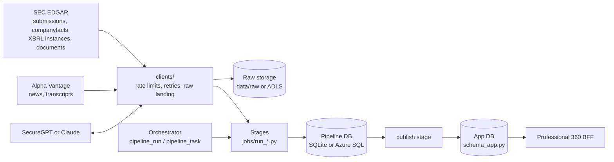
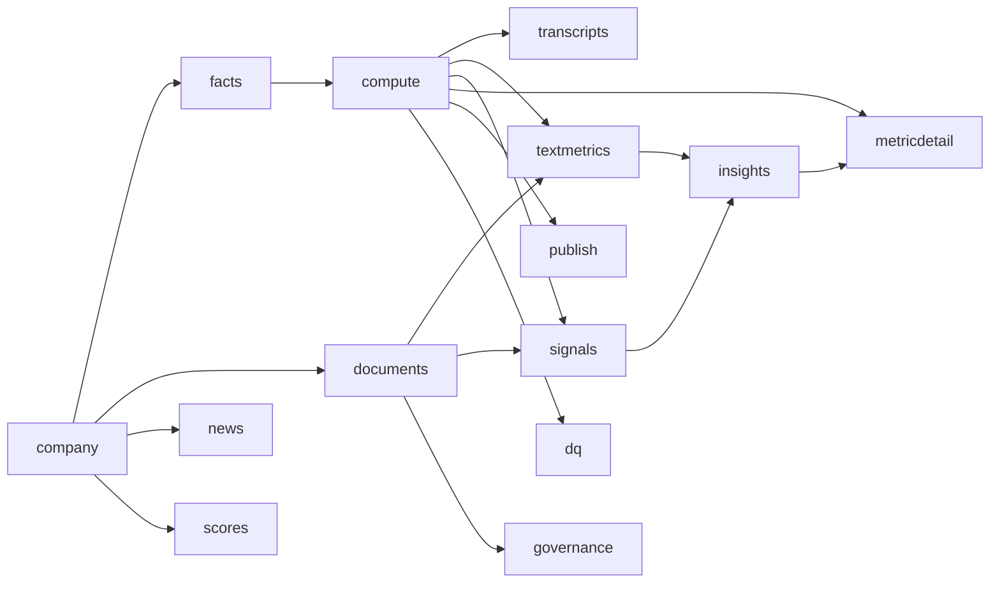

# uw-pipeline: technical overview

For engineers who run, deploy or change the pipeline. As of 2026-10-14 (Phases 1–9 and 11–14
done; Phase 10 planned, on hold). Related documents:

| Document | Holds |
|---|---|
| `docs/PLAN.md` | Plan of record, phase checklists, open questions |
| `docs/decisions.md` | Every design decision with its reason (D-001 … D-046), cited below as D-xxx |
| `docs/OPERATIONS.md` | Day-to-day operations, troubleshooting (Chinese) |
| `docs/schema-contract.md` | Application tables as the BFF reads them |
| `CLAUDE.md` | Commands and coding conventions |

## 1. What it does

The pipeline fetches SEC EDGAR filings and Alpha Vantage news and transcripts, computes metrics,
detects risk signals, has an LLM extract figures and write insights, and publishes the result
into the application database that the Professional 360 BFF reads. Four properties are
designed in and tested:

- **Traceable.** Every value and insight links to a document (accession, URL, section) or
  metric row. LLM output is stored only after schema validation and grounding (§8).
- **Industry-aware.** Metric sets are curated per industry group in `config/`, plus trait
  sets (bank, lodging, contract revenue, manufacturing, captive finance) a group opts into;
  bank modules (NIM, CET1, NPL, loan book) never appear for non-banks.
- **Idempotent.** Natural-key upserts; a rerun on unchanged input writes nothing and calls no
  LLM.
- **Incremental.** Raw responses are cached; LLM calls are cached by input hash; insights are
  regenerated only when their input hash changes.

## 2. Architecture



All external calls go through `src/uw_pipeline/clients/` (HTTP, LLM, database, storage), so tests
swap them for fakes.

## 3. Code layout (`src/uw_pipeline/`)

| Package / module | Responsibility |
|---|---|
| `cli.py` | Typer CLI: `run`, `runs`, `dq-report`, `coverage-report`, `audit-insights`, `review` (list / approve / reject), `init-db` |
| `settings.py` | Settings from environment / `.env` (pydantic-settings), §13 |
| `config.py` | Loads companies and industry groups (traits merged into each group's metric sets) |
| `clients/` | `sec.py` (EDGAR, 8 req/s token bucket, raw landing), `alphavantage.py` (quota, key masking), `llm.py` (Claude), `securegpt.py` (Azure OpenAI gateway), `db.py` (engines, Azure SQL URL, schemas), `storage.py` (local / ADLS), `ratelimit.py` |
| `extract/` | Company metadata, filing lists from submissions |
| `normalize/` | XBRL facts, fiscal periods (restatement basis), HTML to text, table grids (`table_grid.py`), section splitting, news normalisation |
| `compute/` | Metric registry (from `config/metrics.yaml`), formulas, coverage |
| `signals/` | Rule detection, rule loading, rules + LLM vote |
| `enrich/` | LLM tasks: text metrics, insights, news events and relevance, metric detail; `llm.py` (cache, validation), `grounding.py`, `schemas.py`, `package.py` (insight input), `sources.py` (source titles), `table_reader.py` (cell checks), `untrusted.py` (prompt-injection defense), `audit.py`, `prompts/` |
| `jobs/` | One module per stage (`run_*.py`), `run_review.py` (human review queue), `stages.py` (stage dispatch), `orchestrator.py` (runs, tasks, lock, resume) |
| `load/` | `upsert.py` (SQLite / SQL Server upsert, chunked deletes), `app_writer.py` (app ids and versions) |
| `quality/dq.py`, `quality/identities.py` | Data-quality rules; metric identities (also the textmetrics gate) |
| `schema.py`, `schema_app.py` | Pipeline tables (36), application tables (23) |
| `logs.py`, `frames.py` | JSON logging with run context; pandas helpers |

## 4. Stages

Each stage runs per company. `jobs/orchestrator.DEPENDS` declares prerequisites; when one fails
for a company, that company's dependent stages are SKIPPED and other companies continue.



| Stage | Module | Does | Writes | External |
|---|---|---|---|---|
| company | `run_company` | Company metadata; pinned CIK, ticker check (D-006) | `company` | SEC |
| facts | `run_xbrl` | XBRL facts for the tags in the registry, from companyfacts plus filing instances for recent or dimensional facts (D-013, D-014), and pay versus performance from the latest two proxy statements (D-042) | `xbrl_fact`, `ingest_state` | SEC |
| compute | `run_xbrl` | Metrics per period from `config/metrics.yaml`; Q4 = FY − 9M; N/M handling (D-019) | `metric_definition`, `metric_value` | – |
| documents | `run_documents` | Registers 10-K/10-Q/8-K; downloads and splits text documents and EX-99.1 releases (D-023…D-026); downloads the latest proxy (DEF 14A, D-045) | `source_document`, `filing_section`, `section_chunk` | SEC |
| transcripts | `run_transcripts` | Last 4 fiscal quarters of earnings-call transcripts (D-030) | `source_document`, sections, chunks | AV |
| news | `run_news` | 30-day news, mention filter, 3-tier de-duplication, LLM relevance verdict (D-029, D-037) | `news_item`, `activity` | AV, LLM |
| scores | `run_scores` | News risk scores per activity; transcript tone and risk flags (D-037) | `news_risk_score`, `transcript_tone`, `transcript_flag` | LLM |
| textmetrics | `run_text_metrics` | Figures from MD&A and releases (NIM, LCR, …); table metrics read by cell (RevPAR, occupancy, ADR, AUM, VaR, international revenue, average interest-earning assets, capacity utilization) and the loan book; values XBRL covers (capital ratios, release figures) only cross-checked; identity gate (D-022, D-032, D-042, D-044) | `metric_value` (LLM_EXTRACTED, PRELIMINARY), `loan_portfolio_*`, `release_check` | LLM |
| governance | `run_governance` | Board composition from the latest proxy, both models, facts kept only when quoted and agreed (D-045) | `board_composition` | LLM |
| signals | `run_signals` | 8-K, keyword, auditor, metric and board signals; LLM vote on judgment topics (D-027, D-028, D-045) | `signal`, `signal_vote` | LLM |
| insights | `run_insights` | Activity summaries, behavioral, strategic & risk, key insights, follow-up questions (D-033) | `insight*`, `followup_question*`, `activity` | LLM |
| metricdetail | `run_metric_detail` | Methodology and sources by rules; underwriting relevance by LLM (D-036) | `metric_detail`, `metric_source`, `metric_insight` | LLM |
| publish | `run_publish` | Writes the app database (§11) | app tables | – |
| dq | `run_dq` | Data-quality findings (§12) | `dq_finding` | – |

Adding a stage needs an entry in `DEPENDS`, in `jobs/stages.StageRunner._stage` and in
`config/jobs.yaml`.

## 5. Runs, jobs and scheduling

**Run state** (`jobs/orchestrator.py`): one `pipeline_run` per job run, one `pipeline_task`
per (company, stage), executed stage by stage. Task states: PENDING → RUNNING → SUCCEEDED /
FAILED / SKIPPED. Run states: SUCCEEDED, PARTIAL, FAILED, RUNNING.

| Mechanism | Behaviour | Setting (`config/jobs.yaml`) |
|---|---|---|
| Retry | A failed task is retried at once, unless the error is permanent (quota, premium endpoint, missing key) | `max_attempts: 2` |
| Run lock | Any RUNNING run with a fresh heartbeat blocks a new start of any job; the CLI exits with code 2 | `stale_after_minutes: 30` |
| Heartbeat | A background thread refreshes `heartbeat_at` while a task runs | `heartbeat_minutes: 5` |
| Resume | A dead run (stale heartbeat) is resumed only by the same job with the same stages and companies, started less than `resume_within_hours` ago; finished tasks are kept | `resume_within_hours: 12` |
| Abandon | Older or different dead runs are closed (FAILED, `"abandoned": true`) and the new run starts fresh | – |

**Jobs** (`config/jobs.yaml`) and OpenShift CronJobs (`deploy/openshift/cronjobs.yaml`, time zone
America/New_York, `concurrencyPolicy: Forbid`):

| Job | Schedule (ET) | Stages |
|---|---|---|
| `nightly` | 23:30 | company, facts, compute, documents, transcripts, scores, textmetrics, governance, signals, insights, metricdetail, publish, dq |
| `morning` | 05:30 | same as nightly (catch-up) |
| `news` | 03:00, 09:00, 15:00, 21:00 | news, scores, publish |

`nightly` and `morning` set `refresh_sec: true`: submissions and companyfacts are fetched again
even when a same-day copy exists (each lands under a timestamped key). Manual runs reuse the
same-day cache; `--force` refetches and ignores input hashes.

**Run statistics** (`pipeline_run.stats_json`, shown by `uw-pipeline runs`): task counts, SEC
requests, Alpha Vantage calls, LLM calls, tokens and estimated cost per model.

## 6. Data model

### Pipeline database (`schema.py`, 36 tables)

| Area | Tables |
|---|---|
| Company and raw facts | `company`, `ingest_state`, `xbrl_fact`, `metric_definition`, `metric_value` |
| Documents | `source_document`, `filing_section`, `section_chunk` |
| Signals | `signal`, `signal_vote` |
| News | `news_item`, `activity`, `news_risk_score` |
| Transcripts | `transcript_tone`, `transcript_flag` |
| Text metrics | `loan_portfolio_segment`, `loan_portfolio_detail`, `release_check` |
| Insights | `insight`, `insight_evidence`, `insight_link`, `insight_metric`, `followup_question`, `followup_question_insight`, `followup_question_metric`, `followup_question_source` |
| Metric detail | `metric_detail`, `metric_source`, `metric_insight` |
| LLM | `llm_call` (cache), `llm_task_stat` (grounding drop rates) |
| Runs and quality | `pipeline_run`, `pipeline_task`, `dq_finding`, `review_decision` |
| Governance | `board_composition` |

Conventions:

- `metric_value`: FY rows have `fiscal_quarter = 0`; N/M values are `value = NULL,
  value_status = 'NM'`; growth is a fraction. `derivation` is REPORTED / DERIVED / COMPUTED
  (owned by `compute`) or LLM_EXTRACTED / PRELIMINARY (owned by `textmetrics`). Each stage
  deletes only the rows it owns that the current rules no longer produce, so a 10-Q value
  replaces a PRELIMINARY one (D-019, D-032).
- `xbrl_fact` keeps only the tags the registry uses, keyed by `fact_key` (a hash, because a
  nullable start date breaks SQL uniqueness) (D-015).
- Insight sets are versioned by input hash (inputs, prompts, model, `GROUNDING_VERSION`); a new
  set becomes `is_current` and old sets are kept (D-033).
- Signals keep `detected_at` across reruns; `signal_key` = hash(company, rule, accession,
  section, extra) (D-027).

### Application database (`schema_app.py`, 23 tables)

The team's data model diagram, with the changes in D-037: new `ItemLink` and
`CompanyMetricDetail`, a few added columns, and `pipeline_publish_map` (pipeline bookkeeping).
The column-level mapping to the front end is in `docs/schema-contract.md`. Tables owned by the
application (users, favorites, history) are not touched.

## 7. Configuration (`config/`)

Rules, mappings and thresholds live here, never in code. The image bakes `config/` in, so it is
versioned with the code.

| File | Controls |
|---|---|
| `companies.yaml` | Companies: pinned CIK, display ticker, former tickers, `history_start`, `news_aliases`, `av_symbols` |
| `company_overrides/*.yaml` | Company metrics and `sections:` rules (JPM, MAR) |
| `industry_groups.yaml` | SIC → industry group, metric sets, `traits`, `trait_metric_sets`, `common_metric_sets` (governance), `is_financial`, `mdna_history_years` |
| `metrics.yaml` | Metric definitions, formulas (`x_py` = a year earlier), text and table extraction specs (`table:` column, scope, excluded rows), `insight_input`, `metric_sets` |
| `concept_map.yaml` | Concept → candidate XBRL tags (with dimensions) |
| `coverage_notes.yaml` | Reason for every metric gap `coverage-report` shows |
| `signal_rules.yaml` | 8-K item mapping, keyword and role rules, board rules, `fetch_body_items` |
| `text_extraction.yaml` | Text-metric chunk budget, effort, loan portfolio settings |
| `insights.yaml` | Insight tasks, package limits, `news_materiality` gate |
| `news.yaml` | De-duplication thresholds, mention filter, relevance verdict |
| `scores.yaml` | News and transcript risk scoring |
| `llm.yaml` | Provider profiles (models, effort, token limits, prices), signal topics, `max_input_chars` |
| `securegpt.yaml` | Gateway and token URLs per environment, API version, deployments |
| `azure.yaml` | Azure SQL server, database, schemas; ADLS account, container, root (placeholders) |
| `app_publish.yaml` | Metric categories, RiskTypes regex rules, confidence rules, trend and loan metrics |
| `source_labels.yaml` | Readable names for sections and concepts |
| `dq_rules.yaml` | Data-quality thresholds; `metric_identities` (also the textmetrics gate: RevPAR, capital ratios, loan book, debt completeness, NIM relation) |
| `jobs.yaml` | Jobs and orchestrator settings (§5) |

## 8. LLM layer

**Providers** (`config/llm.yaml`, D-039). One profile per provider with three roles; `LLM_PROVIDER`
selects it, default `securegpt`:

| Role | Used for | securegpt | anthropic |
|---|---|---|---|
| extractor | Signal votes, text-metric first pass, news grouping and relevance, activity summaries, risk scores | gpt-5-nano | Claude Haiku 5.5 |
| tiebreaker | Signal tie-breaks, second model of the dual check | gpt-5-mini | Claude Sonnet 5.5 |
| synthesis | Behavioral, strategic & risk, key insights, follow-ups, metric relevance | gpt-5-mini | Claude Sonnet 5.5 |

Both clients implement `complete_json` with structured outputs (strict JSON schema; every output
schema is checked against strict-mode rules in a test). Errors are classified:
`LLMError` fails one item (refusal, truncation, content filter, request too large);
`LLMSetupError` (bad credentials, unknown model or deployment) stops LLM use for the run, and
the stages fall back to rules (`signals`) or fail (`textmetrics`, `insights`).
`LLM_ENABLED=false` runs rules only.

**Cache** (`enrich/llm.cached_call`). Every call is stored in `llm_call`, keyed by a hash of
task, prompt version, model, effort, system prompt, user prompt and schema; an unchanged input
is never sent twice, and each provider keeps its own entries. Output is schema-validated before
it is cached; an invalid output is recorded as an error and asked again next run. On SQL Server
the cache row commits in its own transaction, so a stage that rolls back keeps calls already
paid for.

**Prompts** live in `enrich/prompts/{task}_v{N}.md` (`common_v1` holds the shared rules: cite
everything, numbers only from the input, no underwriting decisions). A change is a new version,
which also invalidates the cache; then run `scripts/export_golden.py` and review
`git diff tests/golden`.

**Grounding** (`enrich/grounding.py`, `enrich/insights.py`, `enrich/text_metrics.py`):

- A quote must be found in its source after normalising whitespace, quote style and case.
  Elided quotes ("a … b") pass when every piece (≥ 8 characters) is found, in order. Footnote
  markers glued to words or in parentheses are ignored.
- Every financial number in an insight must match a package metric (unit conversion and
  rounding allowed) or appear as written in a cited item; digits match only as whole numbers.
  Years, quarter numbers and small counts are ignored.
- Text-metric values are kept only if the quote is in the source, the number is in the quote,
  the unit fits and the period length fits (quarter 75–105 days, year 350–380).
- Failing items are dropped and logged; drop rates go to `llm_task_stat` (DQ alerts above 20%).
- `GROUNDING_VERSION` (`jobs/run_insights.py`, now 7) is part of the insight input hash: bump
  it when grounding rules change, and cached outputs are re-checked without new LLM calls.

**Structured first, identities** (D-042). A value XBRL tags is never taken from text: capital
ratios come from the instances (concepts with `unit: pure` refuse regulatory-floor tags), and
their text extraction only fills periods without XBRL or cross-checks them. Identities in
`config/dq_rules.yaml` (RevPAR = ADR × occupancy; CET1 ≤ Tier 1 ≤ total capital; loan book ≤
total loans) drop text values that break them; the dq stage reports stored values that do.

**Tables by cell, untrusted text** (D-044). Metrics with `extraction.table` are read from table
grids (`normalize/table_grid.py`): the model names table, row and column, and
`enrich/table_reader.check_cell` / `check_loan` verify the cell's number, its column header
(metric, period, not a change column) and its row (scope, not a subset) without repairing a
wrong answer. Every prompt passes through `enrich/untrusted.py`: invisible characters made
visible, sources in escaped blocks, the data rule (`prompts/untrusted_data_v1.md`) appended to
the system prompt. `LLM_DAILY_BUDGET` caps new calls per day (D-043): over it, an item fails
(`BudgetExceededError`), nothing is stored, and the next run continues.

**Agreement checks.** Judgment signals: rules vote, the extractor votes with a verbatim quote,
and only on disagreement the tie-breaker rules on both claims; a rule hit voted down by both
models is kept as OVERRULED, three different answers as DISPUTED (D-028). Bank metrics and the
loan book need extractor and tie-breaker to agree within 0.5% (D-032). Where the two models read
a loan segment at different levels (one line vs. its classes) and the classes add up to the
line, the line is kept (D-044). Board facts need both models to give the same value (D-045).

**Human review** (`uw-pipeline review`, D-045). DISPUTED / OVERRULED signals and identity
breaks are listed with evidence and source link; a named reviewer approves or rejects
(`review_decision`). A rejected signal leaves the insight input and the dq review queue.

## 9. Raw storage

`clients/storage.py` defines the `Storage` protocol (`exists`, `read_bytes`, `write_bytes`,
`delete`). `LocalStorage` writes under `data/raw/`; `AdlsStorage` (`STORAGE_BACKEND=adls`)
writes the same keys under a root prefix in an ADLS Gen2 container. Both write to a temporary
name and rename, so a killed run never leaves a partial file. Tables store keys in `raw_path`,
so data moves between backends without rewriting the database.

Key layout: `{source}/{endpoint}/{id}/{YYYY-MM-DD}.json` (one file per resource per UTC day,
D-004); scheduled jobs add a timestamp; filing documents and published transcripts are immutable
and cached without a date.

## 10. Databases

| | Development | Corporate deployment |
|---|---|---|
| Pipeline DB | SQLite `data/uw.db` (`DATABASE_URL`) | Azure SQL, schema `pipeline_schema` |
| App DB | SQLite `data/app.db` (`APP_DATABASE_URL`) | Azure SQL, schema `app_schema` |
| Switch | default | `DATABASE_BACKEND=azure_sql`, `AZURE_ENV`, `AZURE_SQL_CLIENT_ID/SECRET` |
| Tables | `ensure_schema` creates tables and adds nullable columns | Reviewed DDL in `deploy/sql/`, applied by an engineer |

Azure SQL (D-040): service principal, `Encrypt=yes`, `TrustServerCertificate=no`, MARS on.
Tables are defined without a schema and each engine maps them with `schema_translate_map`. The
two schemas are required: SQL Server names are case-insensitive, so the app's `Company` and the
pipeline's `company` would collide.

Write rules (`load/upsert.py`):

- `upsert` / `insert_missing` de-duplicate rows by key, then use `INSERT … ON CONFLICT` on
  SQLite, or a `#stg_<table>` temp table plus `MERGE … WITH (HOLDLOCK)` on SQL Server. The
  staging insert uses pyodbc `fast_executemany` with explicit parameter types (NVARCHAR(max)
  for long text, DATETIME2(7) for timestamps): pyodbc cannot describe a temp table's
  parameters, and without the types long text is truncated and microseconds are lost.
- `delete_keys` deletes by composite keys in chunks (SQL Server has no multi-column `IN` and
  allows 2,100 parameters per statement). Deletes follow foreign keys (children first).
- Never delete-all-then-insert; never filter booleans with `IS 1` (use `== true()`); read a
  result fully (`.all()`) before issuing the next query on the same connection.

DDL: `scripts/export_app_ddl.py` writes `deploy/sql/app_schema_changes.sql` (changes to the
team's diagram), `app_schema_full.sql` and `pipeline_schema_full.sql`, schema-qualified from
`config/azure.yaml` and safe to run twice. Rerun it after any table change and commit the output.

## 11. Publish (application database)

`jobs/run_publish.py` writes one company per transaction through `load/app_writer.AppWriter`:

- `pipeline_publish_map` maps (entity, pipeline key) → app id plus a content hash. A rerun
  updates the same row; an unchanged row is not written; a row deleted outside the pipeline is
  inserted again. Keys start with the company CIK, and existence checks read only that
  company's rows.
- Versioned entities (`KeyInsights`, `StrategicRisk`, `FollowUpQuestions`): changed content is a
  new row and the old one gets `isActive = 0`, so user flags never move to different text.
  Retired rows are not examined again.
- Other entities (`MatrixData`, `Trend`, `LoanPortfolio`, `CompanyMetricDetail`, `Activities`,
  `News`, `TranscriptToneAnalysis`, `ItemLink`) are updated in place, and stale rows are
  deleted (dependent `NewsRiskScore` rows first).
- `ItemLink` connects active rows only. `NewsRiskScore` keeps one current run per article and
  points to the app's `Activities.ActivityId`. `TranscriptRiskFlag` rows are written only when
  they change.
- Lookup tables (SIC codes, metrics, RiskTypes, LoanTypes, …) are mapped by rules in
  `config/app_publish.yaml`; publishing needs no LLM.

## 12. Data quality and audits

The `dq` stage runs last in `nightly` and `morning` and writes `dq_finding`; findings never fail
the task. Rules (`config/dq_rules.yaml`, D-035, D-036): missing core metric, quarter jump
(> 500% vs prior quarter and vs a year earlier), negative positive-only metric, four quarters ≠
fiscal year (> 0.5%), press release ≠ XBRL, metric identities (Error), total debt without a
current portion (Warning), grounding drop rate > 20% in 30 days, no 10-K/10-Q for 120 days,
review queue (undecided DISPUTED / OVERRULED signals), detail and source coverage, link
integrity.

| Command | Checks |
|---|---|
| `uw-pipeline dq-report` | Findings of a run → `data/reports/dq-run<id>.md` |
| `uw-pipeline coverage-report` | XBRL metric coverage; every gap needs a note in `coverage_notes.yaml` |
| `uw-pipeline audit-insights` | Re-finds a sample's evidence in the sources; no insight without evidence; no FI data for non-FI companies; loan rows found in the cited filing |

## 13. Settings and secrets

Settings come from environment variables or a local `.env` (git-ignored). Secrets come only from
the environment and never appear in code, logs or fixtures; Alpha Vantage messages are masked
because the service echoes the key.

| Variable | Default | Purpose |
|---|---|---|
| `SEC_USER_AGENT` | required | Name and e-mail for SEC requests |
| `SEC_RATE_LIMIT_PER_SEC` | 8 | Must stay ≤ 10 (SEC limit) |
| `DATABASE_URL`, `APP_DATABASE_URL` | SQLite under `data/` | Development databases |
| `DATABASE_BACKEND` | `url` | `azure_sql` for Azure SQL; any other value fails at startup |
| `STORAGE_BACKEND` | `local` | `adls` for ADLS |
| `AZURE_ENV` | from `azure.yaml` | dv / pp / pr |
| `AZURE_SQL_CLIENT_ID`, `AZURE_SQL_CLIENT_SECRET` | – | Azure SQL service principal |
| `ADLS_CLIENT_ID`, `ADLS_CLIENT_SECRET` | – | ADLS service principal |
| `LLM_PROVIDER` | `securegpt` | `anthropic` for development off the corporate network |
| `SECUREGPT_CLIENT_ID`, `SECUREGPT_CLIENT_SECRET`, `SECUREGPT_SUBSCRIPTION_KEY`, `SECUREGPT_ENV` | – | SecureGPT gateway |
| `ANTHROPIC_API_KEY` | – | Claude (development) |
| `ALPHAVANTAGE_API_KEY` | – | Alpha Vantage |
| `LLM_DAILY_BUDGET` | 25 | New LLM spend per day in the profile's currency; 0 = unlimited |
| `ALPHAVANTAGE_CALLS_PER_MINUTE`, `ALPHAVANTAGE_DAILY_QUOTA` | 5, 25 | Paid plan: 75 and 0 (unlimited) |
| `LLM_ENABLED` | true | `false` runs rules only |
| `LOG_FORMAT` | text | `json`: one object per line with run, job, ticker and stage |

## 14. Build and deployment

- **Image** (`Dockerfile`): `build` stage makes wheels (with the `azure` extra); `odbc` installs
  Microsoft ODBC Driver 18 and `libgssapi-krb5-2`; `test` installs the dev extras for the SQL
  Server test run; the final stage runs as a non-root, group-0-writable user for OpenShift. The
  base image and package mirror are build arguments (Artifactory placeholders). Default command:
  `uw-pipeline run --job nightly`.
- **OpenShift** (`deploy/openshift/`): three CronJobs, a PVC (raw data and dev SQLite until ADLS
  and Azure SQL are in use) and a secret example (keys only). `deploy/harness/pipeline.yaml` is
  a CI/CD skeleton. Placeholders are marked `PLACEHOLDER_*`.
- **Before the first run on the corporate network:** fill in `config/azure.yaml`; apply
  `deploy/sql/*.sql`; run `scripts/azure_smoke.py` (connections, schemas, tables, permissions,
  ADLS read/write) and `scripts/securegpt_smoke.py` (each model once, `reasoning_effort`
  support).

## 15. Testing

```bash
.venv/bin/pytest -q                       # 298 passed, 4 skipped (SQL Server only), 2026-10-14
.venv/bin/ruff check . && .venv/bin/ruff format --check . && .venv/bin/mypy   # mypy strict
scripts/test_mssql.sh --all               # whole suite on SQL Server 2022 in Docker: 302 passed
.venv/bin/python scripts/stability_check.py --faults MAR   # timeout / rate limit / bad output fail closed
.venv/bin/python scripts/stability_check.py --runs 3 MAR JPM   # live: same input, same results? (costs)
```

- Unit tests cannot reach the network: `tests/conftest.py` blocks sockets. HTTP is mocked with
  respx; recorded SEC and Alpha Vantage responses are in `tests/fixtures/`
  (`scripts/refresh_sec_fixtures.py` rebuilds the SEC ones).
- LLM calls use `tests/fake_llm.py`, never a real API.
- Golden values come from the filings themselves (D-020). Table reading has a holdout set
  (`tests/fixtures/sec/holdout/`: Hilton, Hyatt, Marriott release, JPM) with right cells and
  plausible wrong ones, plus prompt-injection cases (D-044). `tests/golden/` holds MAR, JPM and ENPH
  insight outputs as the baseline for prompt changes.
- `scripts/test_mssql.sh` starts a throwaway SQL Server container; with `--all`
  (`UW_TEST_ON_MSSQL=1`) every in-memory SQLite engine in the tests becomes a SQL Server engine
  with its own schema. Run it after any database change.
- Regression rule: every false positive found in signals becomes a test in
  `tests/test_signals.py`.

## 16. Known limitations

| Limitation | Effect | Where it is tracked |
|---|---|---|
| Restatements: a quarter restated after its year keeps the year's basis until the year is restated too | Old quarters show the basis they were first reported on; DQ flags quarters ≠ year | D-035, D-046 |
| Live stability: values never differed across runs, but some are withheld in one run and stored in another | Coverage of rarely-tabled figures (AUM, LCR, VaR quarters) can vary when a new filing arrives | D-046 |
| One database transaction per company and stage includes the network and LLM calls | Fine for one process; must be split before parallel workers | PLAN 10.E |
| SQLite allows one writer | Jobs are serialised by the global run lock | D-034, D-041 |
| SEC data is fetched per company on every scheduled run | Fine for 9 companies; daily index and bulk files needed at scale | PLAN Phase 10 |
| Transcripts have no public URL | Insights resting only on transcripts have a title but no link or date | D-036 |
| SecureGPT not yet run on the work network | `reasoning_effort` off; production gateway URL assumed; quality and cost unmeasured | D-039, PLAN Phase 11 |
| Azure settings are placeholders | No run on Azure SQL / ADLS yet | D-040, PLAN Phase 12 |
| BFF contract not reviewed against the BFF code | Mapping is to the data model diagram only | PLAN Phase 0, `schema-contract.md` |

## 17. Common changes

| Change | Steps |
|---|---|
| Add a company | `config/companies.yaml` (pinned CIK); run; fill gaps in `coverage_notes.yaml` (OPERATIONS §2) |
| Add or change a metric | `config/metrics.yaml` and the group's metric set; never per run (OPERATIONS §3) |
| Change a prompt | New `_v<N+1>.md`, bump the version in config, rerun golden companies, `export_golden.py`, review the diff (OPERATIONS §6) |
| Change grounding | Bump `GROUNDING_VERSION` |
| Change a table | `schema.py` / `schema_app.py`; new columns nullable; rerun `export_app_ddl.py`; `scripts/test_mssql.sh --all` |
| Add a stage | `DEPENDS`, `StageRunner._stage`, `config/jobs.yaml`, tests |
